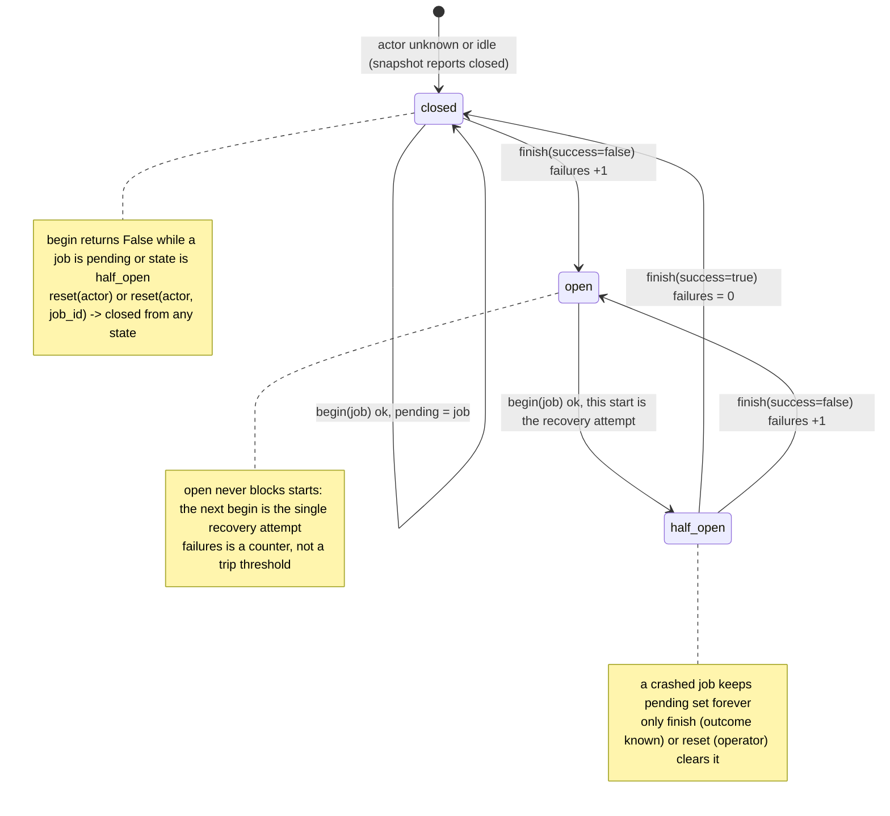
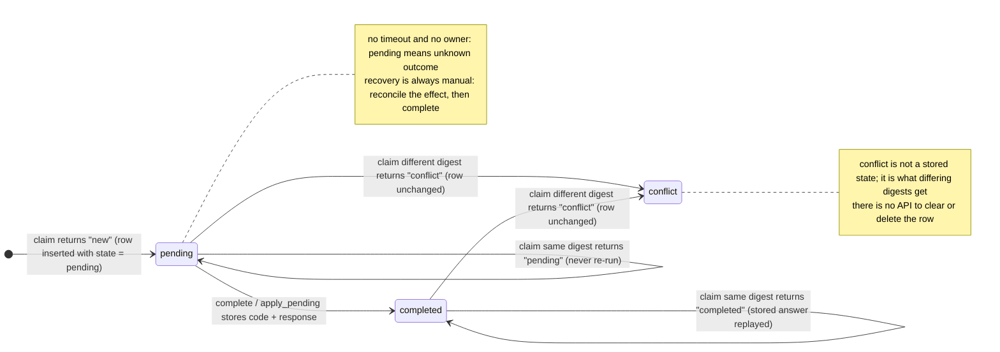

# Architecture — joons_agent_guard 0.1.0

Design of the package as built: standard library only (`sqlite3`, `hashlib`,
`json`, `uuid`, `time`, `contextlib`, `dataclasses`), one SQLite database
file per coordination domain, four tables, one shared transaction pattern.

```
joons_agent_guard
├── _db.py       connect() + write_txn() + close(): the only SQLite machinery
├── errors.py    GuardError family + require_ids() identifier validation
├── lock.py      ResourceLock      (table: resource_locks)
├── circuit.py   CircuitBreaker    (table: worker_circuits)
└── replay.py    ReplayGuard       (tables: requests, outbound_requests)
```

Every component follows the same shape: a constructor
`(path, *, timeout: float)` that opens one connection via `_db.connect`, runs
its `CREATE TABLE IF NOT EXISTS` statements in autocommit, and exposes
mutating operations as `with _db.write_txn(self._db): ...` blocks; reads are
single autocommit statements. `close()` closes the connection under the same
guard lock — it waits for any in-flight transaction of another thread — and
the classes are context managers that do the same. Components do not couple to each
other: their tables are independent, so several components may share one file
or each may own its own.

---

## 1. Storage: exact schemas

Statement text identical to the `_SCHEMA` constants of each module
(token-for-token; line breaks added for readability).

`joons_agent_guard.lock` — `resource_locks`:

```sql
CREATE TABLE IF NOT EXISTS resource_locks (
  resource TEXT PRIMARY KEY,
  owner TEXT NOT NULL,
  job_id TEXT NOT NULL,
  acquired REAL NOT NULL)
```

* One row per **held** lock; an absent row means the resource is free.
  `resource` is the primary key, which is what makes the lock exclusive.
* `acquired` is a `time.time()` wall-clock float, used only by
  `list_locks`'s `ORDER BY acquired` and by humans; never for expiry.

`joons_agent_guard.circuit` — `worker_circuits`:

```sql
CREATE TABLE IF NOT EXISTS worker_circuits (
  actor TEXT PRIMARY KEY,
  state TEXT NOT NULL,
  pending TEXT,
  failures INTEGER NOT NULL,
  reason TEXT,
  updated REAL)
```

* One row per actor that ever began a job. `state` ∈ `closed | open |
  half_open`; `pending` is the in-flight `job_id` or `NULL`.
* `failures` counts consecutive failed finishes; `reason` is the last
  failure's reason string (cleared on success/reset).
* `updated` is written on every mutation but **never read back** by any API
  (it is not even exposed in `CircuitState`) — recorded for operators only.

`joons_agent_guard.replay` — `requests`:

```sql
CREATE TABLE IF NOT EXISTS requests (
  principal TEXT NOT NULL,
  request_id TEXT NOT NULL,
  digest TEXT NOT NULL,
  state TEXT NOT NULL,
  code INTEGER,
  response TEXT,
  claimed REAL,
  PRIMARY KEY(principal, request_id))
```

* One row per inbound request ever claimed — the module contains no
  `DELETE`, so rows accumulate forever. `state` ∈ `pending | completed`
  (the `new`/`conflict` verdicts are never stored).
* `response` is JSON text (`NULL` while pending); `code` is the stored HTTP
  -style integer, `NULL` while pending.
* `claimed` is the Unix time of the first `claim`; it is informational
  (shown by the `pending` CLI command) and never used to re-run or unlock
  anything.

`joons_agent_guard.replay` — `outbound_requests`:

```sql
CREATE TABLE IF NOT EXISTS outbound_requests (
  intent_id TEXT PRIMARY KEY,
  context TEXT NOT NULL)
```

* One row per outbound intent, written once (`ON CONFLICT DO NOTHING`) and
  never deleted. `context` is a JSON object: the caller's `fixed` fields plus
  generated `request_id` (uuid4 hex) and `ts` (`repr(time.time())`).

---

## 2. Transaction pattern

`_db.connect(path, timeout)`:

```python
"""Illustration of _db.connect(path, timeout); the real one lives in _db.py."""
import sqlite3

from joons_agent_guard import _db

db = sqlite3.connect(":memory:", timeout=15.0, isolation_level=None,
                     check_same_thread=False, factory=_db._Connection)  # adds guard_lock
db.execute("PRAGMA busy_timeout=%d" % int(15.0 * 1000))
print("busy_timeout:", db.execute("PRAGMA busy_timeout").fetchone()[0])
db.close()
```

* `isolation_level=None` = **autocommit mode**: Python's implicit transaction
  machinery is off, so every statement not wrapped in an explicit
  transaction commits immediately.
* `busy_timeout` (default 10 s for lock/circuit, 15 s for replay) makes any
  statement that hits a locked database *wait* instead of failing instantly.
* `check_same_thread=False` permits sharing the connection across threads;
  `write_txn` and the read helpers `query_one`/`query_all` hold the
  connection's re-entrant `guard_lock`, so a shared instance is thread-safe;
  `_db.close` takes the same lock, so closing waits for any in-flight
  transaction of another thread.

`_db.write_txn(db)` — the one write pattern used everywhere:

```text
with guard_lock:
    if already in a transaction: raise GuardError   (nested writes are rejected)
    BEGIN IMMEDIATE          (write lock taken up front)
        try: yield
            → COMMIT
        except BaseException: ROLLBACK if still in a transaction; re-raise original
```

Why `BEGIN IMMEDIATE` rather than a deferred transaction: it acquires the
database write lock *before* running any statement, so all cross-process
writer contention funnels into the busy handler and queues cleanly. The
classic alternative — `BEGIN` deferred, then upgrade on first write —
deadlocks when two readers both try to upgrade, and one of them fails
immediately with `SQLITE_BUSY` regardless of `busy_timeout`.

Notes with consequences:

1. If `BEGIN IMMEDIATE` itself times out, the exception is raised before the
   `try`, so there is nothing to roll back.
2. Nested writes are rejected up front: when the connection is already inside
   a transaction, `write_txn` raises `GuardError` instead of issuing `BEGIN`.
   An `apply_pending` effect must therefore not call write methods of the
   same instance; reads (`query_one`/`query_all`) are fine.
3. Any exception in the body — including `KeyboardInterrupt` or an effect
   failing inside `apply_pending` — triggers `ROLLBACK` (when the transaction
   is still open) and re-raises the original error.
4. If the body's failure caused SQLite to *auto-rollback* (notably
   `SQLITE_FULL`), the explicit `ROLLBACK` is skipped, so the original
   error (e.g. "database or disk is full") is what the caller sees. A
   failing `COMMIT` is rolled back as well, so the connection is never left
   inside a stale transaction (regression tests: `tests/test_txn.py`).
5. Reads (`status`, `snapshot`, `response`, `list_locks`) never open a
   transaction: each is a single autocommit statement and sees one
   consistent committed snapshot. Two successive reads may straddle another
   process's commit; there is no repeatable-read across calls.

---

## 3. State machines

### CircuitBreaker — closed / open / half_open



Transitions happen only inside `BEGIN IMMEDIATE` transactions, so the
"one pending job per actor" invariant holds across processes.

### ReplayGuard — request lifecycle

Stored states are `pending` and `completed`; `new` and `conflict` are
verdicts returned by `claim`, shown here on the arrows they decide.



Outbound intents have a trivial lifecycle — `outbound_requests` rows are
written once by `reserve_outbound` and never change — so no diagram is
needed.

---

## 4. Why nothing expires by age

All three components record timestamps (`acquired`, `updated`, `ts`) but **no
query or code path ever uses them to invalidate state**. This is deliberate:

1. Stored state means *"the outcome of real-world work is unknown"* — a held
   lock may mean an effect is in progress; a `pending` request may mean the
   effect already happened; a pending circuit slot may mean a recovery
   attempt is running. Time has no bearing on any of these: a lock held for
   three weeks may be perfectly valid (a long job) or fatal (a crash).
2. Auto-expiry would force one of two wrong answers: **re-run** work that may
   already have happened (breaking at-most-once), or **forget** that work was
   in flight (breaking mutual exclusion). The module docstrings state this
   explicitly — "Locks never expire on their own: if a holder crashed, its
   work may be in an unknown state", "it is never cleared by age",
   "it is never re-run or unlocked by age".
3. Therefore every exit from stuck state is an explicit, job-id-checked
   operator action: `break_lock(resource, expected_job_id)`,
   `reset(actor, expected_job_id)`, and `complete(...)` after human
   reconciliation of a pending request. The job-id checks exist so recovery
   cannot clobber state that changed in the meantime.

---

## 5. Data formats

* **Digests** — `request_digest(method, path, body, **fields)` returns a
  SHA-256 hex digest over canonical JSON: keys sorted, separators
  `(",", ":")`, `ensure_ascii=True`, plus `body_sha256` of the raw bytes
  (which must be `bytes`; anything else raises `TypeError`). `body_sha256`
  is reserved — passing it as an extra field raises `ValueError`, it is
  always recomputed from `body` — and every field value must be a `str`
  (`TypeError` otherwise). The same digest must be passed to `claim`,
  `complete`, `response`, `apply_pending`; a mismatch is the `conflict`
  verdict / refused update.
* **Stored responses** — `requests.response` is
  `json.dumps(response, ensure_ascii=True)`; `response()` decodes it with
  `json.loads`. The round-trip is not type-faithful: tuples come back as
  lists and non-str dict keys as strings, so use JSON-stable types.
  `complete`/`apply_pending` require `code` to be an `int` (`bool` rejected
  with `TypeError`).
* **Outbound context** — `json.dumps(candidate, sort_keys=True)`; compared
  field-by-field on reuse to raise `IntentMismatch`.
* **Timestamps** — `time.time()` floats (`acquired`, `updated`) and
  `repr(time.time())` for the outbound `ts`; all wall-clock, for humans and
  ordering only.

## 6. Construction defaults

| Component | `timeout` default | `PRAGMA busy_timeout` | Tables created on first use |
|---|---|---|---|
| `ResourceLock` | 10.0 | 10000 ms | `resource_locks` |
| `CircuitBreaker` | 10.0 | 10000 ms | `worker_circuits` |
| `ReplayGuard` | 15.0 | 15000 ms | `requests`, `outbound_requests` |

Schemas are created with `IF NOT EXISTS` in autocommit at construction, so
creating several instances against the same fresh file concurrently is safe.

## 7. Known sharp edges

* **`updated` column is write-only** — recorded, never returned by the API.
* **No `DELETE` anywhere in `replay.py`** — `requests` and
  `outbound_requests` grow unboundedly; retention is the integrator's job.
