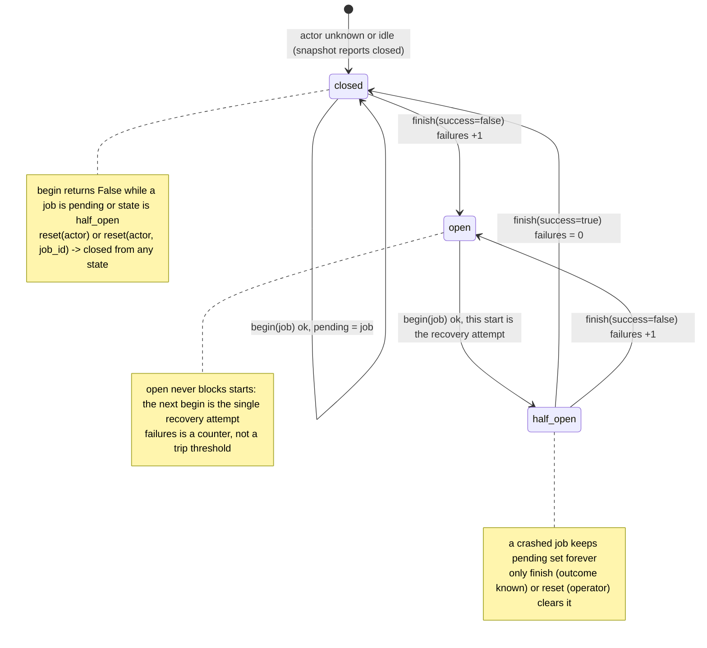
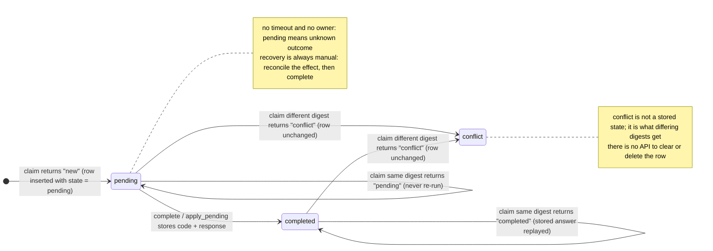

# 아키텍처 — joons_agent_guard 0.1.0

English original: [docs/architecture.md](../architecture.md)

이 패키지의 설계는 다음과 같습니다. 표준 라이브러리만 씁니다(`sqlite3`, `hashlib`, `json`, `uuid`, `time`, `contextlib`, `dataclasses`). 조정 영역(coordination domain)마다 SQLite 데이터베이스 파일 하나를 씁니다. 표는 네 개입니다. 그리고 트랜잭션(transaction) 패턴은 하나를 공유합니다.

```
joons_agent_guard
├── _db.py       connect() + write_txn() + close(): the only SQLite machinery
├── errors.py    GuardError family + require_ids() identifier validation
├── lock.py      ResourceLock      (table: resource_locks)
├── circuit.py   CircuitBreaker    (table: worker_circuits)
└── replay.py    ReplayGuard       (tables: requests, outbound_requests)
```

모든 구성 요소는 같은 형태를 따릅니다. 생성자 `(path, *, timeout: float)`가 `_db.connect`로 연결 하나를 열고, 자동 커밋(autocommit) 방식으로 자기 `CREATE TABLE IF NOT EXISTS` 문을 실행합니다. 그리고 상태를 바꾸는 연산은 `with _db.write_txn(self._db): ...` 블록으로 노출합니다. 읽기는 단일 자동 커밋 문장입니다. `close()`는 같은 가드 잠금 아래에서 연결을 닫습니다. 다른 스레드의 진행 중인 트랜잭션이라면 끝날 때까지 기다립니다. 클래스들은 같은 일을 하는 컨텍스트 관리자(context manager)이기도 합니다. 구성 요소들은 서로 결합하지 않습니다. 표가 독립적이므로, 여러 구성 요소가 한 파일을 함께 쓰거나 각자 자기 파일을 쓸 수 있습니다.

---

## 1. 저장: 정확한 스키마(schema)

문장 텍스트는 각 모듈의 `_SCHEMA` 상수와 동일합니다(한 글자까지 같습니다. 읽기 쉽도록 줄만 바꾸었습니다).

`joons_agent_guard.lock` — `resource_locks`:

```sql
CREATE TABLE IF NOT EXISTS resource_locks (
  resource TEXT PRIMARY KEY,
  owner TEXT NOT NULL,
  job_id TEXT NOT NULL,
  acquired REAL NOT NULL)
```

* **잡힌** 잠금(lock)마다 한 행입니다. 행이 없으면 자원은 놓인 것입니다. `resource`는 기본 키(primary key)입니다. 잠금의 배타성은 이것에서 나옵니다.
* `acquired`는 `time.time()` 벽시계 실수입니다. `list_locks`의 `ORDER BY acquired`와 사람의 눈에만 쓰입니다. 만료(expiry)에는 절대 쓰이지 않습니다.

`joons_agent_guard.circuit` — `worker_circuits`:

```sql
CREATE TABLE IF NOT EXISTS worker_circuits (
  actor TEXT PRIMARY KEY,
  state TEXT NOT NULL,
  pending TEXT,
  failures INTEGER NOT NULL,
  reason TEXT,
  updated REAL)
```

* 한 번이라도 작업을 시작한 작업자(actor)마다 한 행입니다. `state`는 `closed | open | half_open` 가운데 하나입니다. `pending`은 진행 중인 `job_id`이거나 `NULL`입니다.
* `failures`는 연속해서 실패한 finish 횟수입니다. `reason`은 마지막 실패의 이유 문자열입니다(성공/리셋에 지워집니다).
* `updated`는 모든 변경 때 쓰입니다. 그러나 어떤 API도 **다시 읽지 않습니다**(`CircuitState`에도 노출되지 않습니다). 운영자를 위해 기록할 뿐입니다.

`joons_agent_guard.replay` — `requests`:

```sql
CREATE TABLE IF NOT EXISTS requests (
  principal TEXT NOT NULL,
  request_id TEXT NOT NULL,
  digest TEXT NOT NULL,
  state TEXT NOT NULL,
  code INTEGER,
  response TEXT,
  claimed REAL,
  PRIMARY KEY(principal, request_id))
```

* 차지된 적이 있는 안쪽 요청마다 한 행입니다. 모듈 안에는 `DELETE`가 없습니다. 따라서 행은 영원히 쌓입니다. `state`는 `pending | completed`뿐입니다(`new`/`conflict` 판정(verdict)은 저장되지 않습니다).
* `response`는 JSON 텍스트입니다(pending 동안에는 `NULL`). `code`는 저장된 HTTP식 정수이며, pending 동안에는 `NULL`입니다.
* `claimed`는 첫 `claim`의 유닉스 시각입니다. 정보 제공용입니다(`pending` 명령줄 명령이 보여 줍니다). 무엇을 다시 실행하거나 푸는 데는 쓰이지 않습니다.

`joons_agent_guard.replay` — `outbound_requests`:

```sql
CREATE TABLE IF NOT EXISTS outbound_requests (
  intent_id TEXT PRIMARY KEY,
  context TEXT NOT NULL)
```

* 바깥쪽 의도(intent)마다 한 행입니다. 한 번 쓰이고(`ON CONFLICT DO NOTHING`) 절대 지워지지 않습니다. `context`는 JSON 객체입니다. 호출자의 `fixed` 필드와 생성된 `request_id`(uuid4 hex), `ts`(`repr(time.time())`)를 담습니다.

---

## 2. 트랜잭션 패턴

`_db.connect(path, timeout)`:

```python
"""Illustration of _db.connect(path, timeout); the real one lives in _db.py."""
import sqlite3

from joons_agent_guard import _db

db = sqlite3.connect(":memory:", timeout=15.0, isolation_level=None,
                     check_same_thread=False, factory=_db._Connection)  # adds guard_lock
db.execute("PRAGMA busy_timeout=%d" % int(15.0 * 1000))
print("busy_timeout:", db.execute("PRAGMA busy_timeout").fetchone()[0])
db.close()
```

* `isolation_level=None`은 **자동 커밋 모드(autocommit mode)**입니다. 파이썬의 암묵적 트랜잭션 장치가 꺼집니다. 그래서 명시적 트랜잭션으로 감싸지 않은 모든 문장은 즉시 커밋됩니다.
* `busy_timeout`(기본값은 lock/circuit이 10초, replay가 15초)는 잠긴 데이터베이스를 만난 문장이 곧 실패하지 않고 *기다리게* 합니다.
* `check_same_thread=False`는 연결을 스레드 사이에서 공유할 수 있게 합니다. `write_txn`과 읽기 도우미 `query_one`/`query_all`은 연결의 재진입 잠금(re-entrant lock)인 `guard_lock`을 쥡니다. 그래서 공유 인스턴스는 스레드 안전입니다. `_db.close`는 같은 잠금을 잡습니다. 따라서 닫기는 다른 스레드의 진행 중인 트랜잭션을 기다립니다.

`_db.write_txn(db)` — 모든 곳에서 쓰는 유일한 쓰기 패턴입니다:

```text
with guard_lock:
    if already in a transaction: raise GuardError   (nested writes are rejected)
    BEGIN IMMEDIATE          (write lock taken up front)
        try: yield
            → COMMIT
        except BaseException: ROLLBACK if still in a transaction; re-raise original
```

왜 `BEGIN IMMEDIATE`이고 지연(deferred) 트랜잭션이 아닙니까? `BEGIN IMMEDIATE`는 문장을 실행하기 *전에* 데이터베이스 쓰기 잠금을 잡습니다. 그래서 프로세스를 넘나드는 쓰기 경쟁은 모두 바쁨 처리기(busy handler)로 모여 깨끗하게 줄을 섭니다. 고전적인 대안 — `BEGIN` 지연 후 첫 쓰기에서 승격 — 은 두 읽기가 모두 승격을 시도할 때 교착(deadlock)됩니다. 그중 하나는 `busy_timeout`과 무관하게 곧바로 `SQLITE_BUSY`로 실패합니다.

결과까지 함께 이해해야 하는 주의 사항은 다음과 같습니다.

1. `BEGIN IMMEDIATE` 자체가 시간을 넘기면 예외는 `try` 전에 나옵니다. 따라서 롤백할 것이 없습니다.
2. 겹쳐 쓰기는 애초에 거절됩니다. 연결이 이미 트랜잭션 안에 있으면 `write_txn`은 `BEGIN` 대신 `GuardError`를 냅니다. 따라서 `apply_pending` 효과는 같은 인스턴스의 쓰기 메서드를 부르면 안 됩니다. 읽기(`query_one`/`query_all`)는 괜찮습니다.
3. 본문의 모든 예외 — `KeyboardInterrupt`나 `apply_pending` 안에서 실패하는 효과도 포함입니다 — 는 `ROLLBACK`(트랜잭션이 아직 열려 있을 때)을 일으키고 원래 오류를 다시 던집니다.
4. 본문의 실패가 SQLite의 *자동 롤백*을 일으켰다면(특히 `SQLITE_FULL`) 명시적인 `ROLLBACK`은 건너뛰어집니다. 따라서 호출자가 보는 것은 원래 오류(예: "database or disk is full")입니다. 실패한 `COMMIT`도 롤백됩니다. 따라서 연결이 낡은 트랜잭션 안에 남는 일은 없습니다(회귀 시험: `tests/test_txn.py`).
5. 읽기(`status`, `snapshot`, `response`, `list_locks`)는 트랜잭션을 열지 않습니다. 각각은 단일 자동 커밋 문장이며 커밋된 하나의 일관된 스냅숏(snapshot)을 봅니다. 연달아 하는 두 읽기는 다른 프로세스의 커밋을 사이에 둘 수 있습니다. 호출 사이에 반복 가능한 읽기(repeatable-read)는 없습니다.

---

## 3. 상태 기계(state machine)

### CircuitBreaker — closed / open / half_open



전이는 `BEGIN IMMEDIATE` 트랜잭션 안에서만 일어납니다. 그래서 "작업자당 진행 중인 작업 하나"라는 불변식(invariant)이 프로세스를 넘어 성립합니다.

### ReplayGuard — 요청 수명 주기

저장되는 상태는 `pending`과 `completed`입니다. `new`와 `conflict`는 `claim`이 돌려주는 판정이며, 여기서는 그 판정이 결정하는 화살표 위에 표시했습니다.



바깥쪽 의도의 수명 주기는 단순합니다. `outbound_requests` 행은 `reserve_outbound`가 한 번 쓰고 절대 변하지 않습니다. 따라서 그림이 필요 없습니다.

---

## 4. 왜 아무것도 나이로 만료되지 않는가

세 구성 요소는 모두 시각 값을 기록합니다(`acquired`, `updated`, `ts`). 그러나 **그 값으로 상태를 무효화하는 질의나 코드 경로는 없습니다**. 이것은 일부러입니다.

1. 저장된 상태는 *"실세계 작업의 결과를 모른다"*는 뜻입니다. 쥐고 있는 잠금은 작업이 진행 중일 수 있다는 뜻입니다. `pending` 요청은 작업이 이미 일어났을 수 있다는 뜻입니다. 끼어 있는 회로 자리는 회복 시도가 실행 중일 수 있다는 뜻입니다. 시간은 이들 어느 것과도 상관이 없습니다. 3주 동안 쥔 잠금은 완벽히 유효할 수도 있습니다(긴 작업). 아니면 치명적일 수도 있습니다(멈춤).
2. 자동 만료는 둘 중 하나의 잘못된 답을 강요합니다. 이미 일어났을 수 있는 작업을 **다시 실행**하거나(많아야 한 번을 깨뜨립니다), 작업이 진행 중이었음을 **잊는** 것입니다(상호 배제를 깨뜨립니다). 모듈 문서 문자열은 이것을 분명히 말합니다. "Locks never expire on their own: if a holder crashed, its work may be in an unknown state", "it is never cleared by age", "it is never re-run or unlocked by age".
3. 따라서 끼어 있는 상태에서 나오는 모든 출구는 명시적이고 job-id로 확인되는 운영자 행동입니다. `break_lock(resource, expected_job_id)`, `reset(actor, expected_job_id)`, 그리고 사람이 pending 요청을 맞춰 본 뒤의 `complete(...)`가 그것입니다. job-id 검사가 있는 이유는 복구가 그 사이에 바뀐 상태를 덮어쓰지 못하게 하기 위해서입니다.

---

## 5. 데이터 형식

* **다이제스트(digest)** — `request_digest(method, path, body, **fields)`는 정규화된 JSON 위의 SHA-256 16진수 다이제스트를 돌려줍니다. 키는 정렬되고, 구분자는 `(",", ":")`이며, `ensure_ascii=True`입니다. 거기에 원본 바이트의 `body_sha256`이 더해집니다(본문은 `bytes`여야 합니다. 다른 것이면 `TypeError`가 납니다). `body_sha256`은 예약되어 있습니다. 추가 필드로 넘기면 `ValueError`가 나고, 이 값은 언제나 `body`에서 다시 계산됩니다. 모든 필드 값은 `str`이어야 합니다(아니면 `TypeError`). 같은 digest를 `claim`, `complete`, `response`, `apply_pending`에 넘겨야 합니다. 불일치는 `conflict` 판정 또는 거절된 갱신입니다.
* **저장되는 응답** — `requests.response`는 `json.dumps(response, ensure_ascii=True)`입니다. `response()`는 그것을 `json.loads`로 해독합니다. 왕복은 타입을 그대로 보존하지 않습니다. 튜플은 목록으로 돌아옵니다. 문자열이 아닌 사전 키는 문자열로 돌아옵니다. 따라서 JSON에서 안정적인 타입을 쓰십시오. `complete`/`apply_pending`은 `code`가 `int`이기를 요구합니다(`bool`은 `TypeError`로 거절됩니다).
* **바깥쪽 컨텍스트** — `json.dumps(candidate, sort_keys=True)`입니다. 재사용 때는 필드별로 비교하여 `IntentMismatch`를 냅니다.
* **시각 값** — `time.time()` 실수(`acquired`, `updated`)와 바깥쪽 `ts`의 `repr(time.time())`입니다. 모두 벽시계이며, 사람과 정렬을 위해서만 씁니다.

## 6. 생성 기본값

| 구성 요소 | `timeout` 기본값 | `PRAGMA busy_timeout` | 처음 쓸 때 만드는 표 |
|---|---|---|---|
| `ResourceLock` | 10.0 | 10000 ms | `resource_locks` |
| `CircuitBreaker` | 10.0 | 10000 ms | `worker_circuits` |
| `ReplayGuard` | 15.0 | 15000 ms | `requests`, `outbound_requests` |

스키마는 생성 시점에 자동 커밋으로 `IF NOT EXISTS`와 함께 만들어집니다. 따라서 같은 새 파일을 대상으로 여러 인스턴스를 동시에 만들어도 안전합니다.

## 7. 알려진 주의점(sharp edges)

* **`updated` 열은 쓰기 전용입니다** — 기록만 하며 어떤 API도 돌려주지 않습니다.
* **`replay.py` 어디에도 `DELETE`가 없습니다** — `requests`와 `outbound_requests`는 무한히 쌓입니다. 보존 기간은 이것을 쓰는 쪽의 책임입니다.
